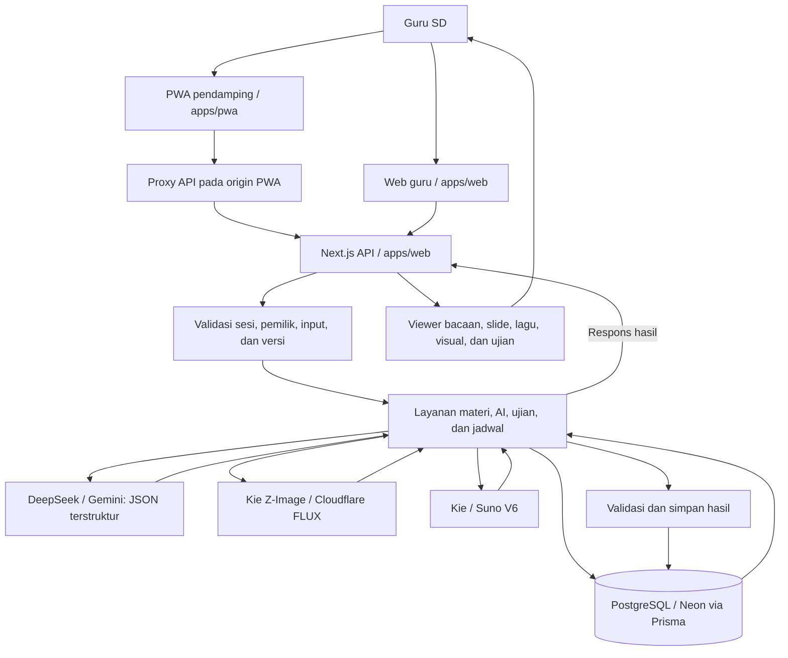
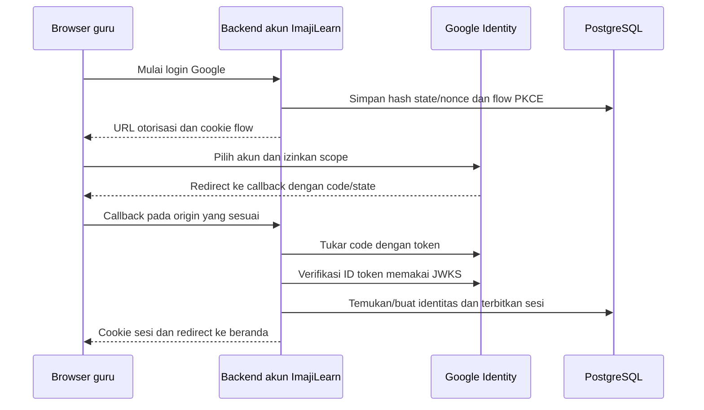

# ImajiLearn

**Mengubah bahan ajar menjadi media pembelajaran interaktif bagi guru SD.**

ImajiLearn membantu guru memilih bagian materi dari PDF atau teks, lalu mengolahnya menjadi bacaan bergambar, slide, lagu belajar, visual interaktif, dan soal ujian. Materi dan hasilnya tersimpan sehingga dapat digunakan kembali saat mengajar.

| Informasi | Keterangan |
| --- | --- |
| Kompetisi | Logicodix 2026 |
| Tim | YOSLO |
| Institusi | Universitas Amikom Yogyakarta, Fakultas Ilmu Komputer |
| Kategori | **Web**; PWA merupakan antarmuka pendamping pada perangkat mobile |
| Subtema | Smart & Fun Education |
| Aplikasi | [imajilearn.ai.id](https://imajilearn.ai.id/) |
| Demo publik | [Coba materi fotosintesis](https://imajilearn.ai.id/demo) |
| PWA | [pwa.imajilearn.ai.id/app](https://pwa.imajilearn.ai.id/app) |
| Repository | [Ilyasrhmn/ImajiLearn](https://github.com/Ilyasrhmn/ImajiLearn) |

## Tim dan kontribusi

| Anggota | Peran dan kontribusi |
| --- | --- |
| **Ilyas Nur Rohman** | **Team Lead, Frontend & AI Engineer**: Menginisiasi ide, menentukan arah produk, dan mengoordinasikan pengembangan. Menangani frontend utama: landing page, demo interaktif, dashboard guru, studio media, viewer pembelajaran, dan editor ujian. Mengerjakan konfigurasi provider AI, generasi bacaan/kuis, slide, ilustrasi, visual interaktif, serta soal ujian; mengintegrasikan Z-Image/Cloudflare dan menyempurnakan variasi lagu Suno serta sinkronisasi karaoke. Turut menangani penyimpanan draf/riwayat, integrasi API, perbaikan PWA/backend, dan pengujian lintas fitur. |
| **Iqbal Maulana Mufid** | **PWA & Backend Engineer**: Mengembangkan struktur dan navigasi PWA, alur akun, pustaka serta unggahan materi, workspace media/ujian, jadwal, dan agenda harian. Mengintegrasikan PWA dengan backend dan komponen bersama, menangani pemasangan aplikasi, fallback offline, pemulihan koneksi, serta pengujian integrasi dan konfigurasi CI PWA. |
| **M Yusril Mubarok** | **Backend & AI Integration Engineer**: Mengembangkan fondasi database, registrasi dan sesi guru, pemeriksaan kepemilikan materi, serta penyimpanan dan API preferensi media. Mengimplementasikan login/penautan Google beserta pengujiannya, serta integrasi awal generasi lagu yang mencakup lirik, pemrosesan tugas, penyimpanan hasil, dan akses audio. |
| **Maulana Adib Sultoni** | **Product Researcher & Ideation Contributor**: Mendukung pengembangan ide melalui riset permasalahan dan kebutuhan pengguna, eksplorasi pendekatan solusi, serta diskusi konsep bersama tim untuk memperjelas pengguna sasaran dan manfaat ImajiLearn. |

Kontribusi saling melengkapi dan tidak terbatas pada satu lapisan aplikasi. Pengembangan teknis dapat ditelusuri melalui riwayat commit dan branch `frontend`, `backend`, `ai-integration`, serta `pwa`.

## Masalah, solusi, dan pengguna

Guru sering sudah memiliki bahan ajar, tetapi menyiapkan bacaan, ilustrasi, presentasi, lagu, dan soal dari sumber yang sama membutuhkan pekerjaan berulang. Materi panjang juga perlu dipilih cakupannya sebelum disampaikan kepada anak SD. Konsep yang abstrak membutuhkan bantuan visual dan interaksi agar lebih mudah dijelaskan.

ImajiLearn menyatukan pekerjaan tersebut: guru mengunggah sumber, memilih halaman atau bagian, membuat media yang diperlukan, meninjau hasil, lalu memakainya di kelas. Pengguna utama adalah **guru SD**; murid menerima pembelajaran melalui layar, proyektor, dan pendampingan guru. MVP berpusat pada akun guru, tanpa akun murid atau pengumpulan data individual siswa.

## Fitur yang diimplementasikan

| Fitur | Fungsi |
| --- | --- |
| Sumber materi | Unggah PDF/TXT atau masukkan teks; pratinjau PDF dan pilih rentang halaman yang relevan. |
| Bacaan bergambar | Penjelasan bertahap, ilustrasi, kuis dengan pembahasan, pembacaan suara, dan mode proyektor. |
| Slide | Ringkasan berpoin dan ilustrasi; navigasi slide, zoom, pembacaan suara, dan mode proyektor. |
| Lagu belajar | Pembuatan lirik, musik dan vokal, pemutar, variasi hasil, serta tampilan lirik/karaoke. |
| Visual interaktif | Penjelasan berbasis sumber pada model yang didukung, termasuk eksplorasi fotosintesis, daun dan kloroplas, model geometri, serta perakitan objek. |
| Soal dan ujian | Pilihan ganda, isian, dan uraian; pengisian AI, penyuntingan tersimpan, kunci, pembahasan, rubrik, kisi-kisi, duplikasi, remedial, serta cetak. |
| Pustaka | Folder mata pelajaran, pencarian, sematkan, arsip/pulihkan, draf, dan riwayat hasil. |
| Jadwal dan beranda | Jadwal semester, validasi benturan, agenda harian, dan akses kembali ke materi. |
| Akun guru | Daftar/masuk dengan email dan kata sandi, profil, logout, serta login/penautan Google jika OAuth dikonfigurasi. |
| PWA | Antarmuka mobile, pemasangan pada browser yang mendukung, dan halaman pemberitahuan saat offline. |

Pembuatan bacaan, slide, lagu, dan visual dapat diminimalkan agar guru bisa berpindah halaman atau mengerjakan materi lain. Indikator progres serta pemberitahuan selesai/gagal tersedia di aplikasi selama tab tetap terbuka. Refresh atau menutup tab menghentikan kelanjutan proses dari browser; hasil yang sudah tersimpan tetap dapat dibuka kembali.

Visual interaktif memakai katalog dan bentuk yang didukung aplikasi, bukan pembuatan model 3D bebas untuk seluruh topik. Pembacaan suara memakai Web Speech API sehingga suara dan dukungan bahasa bergantung pada browser/perangkat. PWA tetap memerlukan koneksi untuk halaman privat, data, dan generasi AI; service worker hanya menyimpan halaman fallback publik.

## Mencoba aplikasi

1. Buka [demo publik](https://imajilearn.ai.id/demo) untuk mencoba materi fotosintesis tanpa login. Demo memakai konten dan media tersimpan; membuka demo tidak membuat permintaan generasi AI baru.
2. Masuk melalui [halaman akun guru](https://imajilearn.ai.id/masuk).
3. Buka **Buat media**, unggah PDF/TXT atau masukkan teks, kemudian pilih sumber dan cakupan halaman.
4. Pilih bacaan, slide, lagu, visual, atau soal dan ujian. Jalankan pembuatan, tunggu prosesnya, lalu tinjau hasilnya.
5. Buka kembali hasil melalui pustaka/riwayat, gunakan mode proyektor, atau cetak naskah ujian sesuai kebutuhan.

### Akun demonstrasi juri

Akun berikut disediakan tim untuk demonstrasi dan pengujian juri:

| Isian | Nilai |
| --- | --- |
| Halaman masuk | [Web](https://imajilearn.ai.id/masuk) / [PWA](https://pwa.imajilearn.ai.id/app/masuk) |
| Email | `admin@imajilearn.com` |
| Kata sandi | `admin123` |

Akun dapat dipakai untuk mencoba area guru dan membuka hasil yang telah tersimpan. Generasi baru memakai layanan dan kuota provider yang dikonfigurasi tim.

## Teknologi

| Lapisan | Teknologi dan perannya |
| --- | --- |
| Frontend | Next.js 16.4.5, React 19.3.1, JavaScript/JSX, dan CSS; npm workspaces untuk monorepo. |
| Backend | Next.js Route Handlers, modul layanan di `apps/web/server`, Node.js, dan validasi kontrak sisi server. |
| Database | PostgreSQL melalui Prisma 7.10.1, `@prisma/adapter-pg`, dan `pg`; deployment tim memakai Neon. |
| Hosting | Vercel untuk deployment aplikasi tim. |
| AI teks | DeepSeek V4.1 Flash melalui KIE, reasoning none; Gemini Flash Lite sebagai cadangan. |
| Ilustrasi | Z-Image melalui Kie.ai dan FLUX.1 Schnell melalui Cloudflare Workers AI. |
| Musik | Suno V6 melalui Kie.ai untuk musik/vokal dan timestamp lirik. |
| Visual | Three.js serta renderer SVG/isometrik untuk objek dan interaksi yang didukung. |
| PDF | PDF.js (`pdfjs-dist`) untuk membaca sumber dan pratinjau PDF; cetak dokumen melalui browser. |
| Identitas | Sesi cookie HttpOnly dan hash kata sandi scrypt; Google OpenID Connect menggunakan `jose`. |
| Antarmuka | Lucide React untuk ikon; Nunito Sans; Google Sans pada kontrol Google. |
| Pengujian | Node.js test runner, PGlite atau PostgreSQL khusus tes, ESLint, dan GitHub Actions. |

## Arsitektur dan alur data



**Alur materi:** unggahan atau teks masuk ke backend, kepemilikan diverifikasi, teks sumber diekstrak dan disimpan, lalu guru memilih cakupan yang diproses. Backend menyusun permintaan AI sesuai fitur, memvalidasi bentuk hasil, dan menyimpan keluaran beserta revisi sumber. Ilustrasi/audio dibuat melalui adapter khusus. Membuka hasil tersimpan menggunakan data yang sudah ada; membuat ulang merupakan tindakan terpisah.

Visual dirender dari deskripsi terstruktur yang cocok dengan katalog aplikasi. File sumber dan keluaran media disimpan melalui database sesuai model Prisma; kode tidak membutuhkan bucket objek eksternal untuk alur yang ada.

Katalog visual juga mencakup sistem pernapasan dengan detail alveolus, musyawarah kelas, angklung, rangkaian listrik sederhana, rantai makanan rumput–kelinci–ular–elang, dan peta Indonesia. Generator memeriksa topik dan kutipan setiap bagian; rantai makanan memeriksa arah hubungan makan. Model tersebut tidak menggantikan topik yang belum didukung. Renderer tambahan dan data peta dimuat saat modelnya dibuka. Garis pantai berasal dari [Natural Earth v5.1.2](https://github.com/nvkelso/natural-earth-vector/tree/v5.1.2), dengan [lisensi domain publik](https://www.naturalearthdata.com/about/terms-of-use/).

Ilustrasi generatif diperiksa terhadap bagian pelajaran sebelum disimpan, untuk menemukan kesalahan besar seperti objek yang salah atau tulisan acak yang dominan. Pemeriksaan memakai Gemini melalui `AI_IMAGE_REVIEW_API_KEY` / `AI_IMAGE_REVIEW_MODEL`, atau kredensial dan model `AI_TEXT_FALLBACK_*` jika konfigurasi khusus tidak diisi. Pemeriksaan AI mengurangi kesalahan, bukan jaminan akurasi ilmiah. Gambar yang relevan dan dapat dikenali tetap diterima meskipun detail kecilnya tidak sempurna. Penolakan kualitas dapat memicu satu pengganti otomatis; pemeriksaan pengganti lebih longgar terhadap detail kecil. Penolakan kedua berhenti dan tidak memicu generasi berbayar berikutnya. Jika pemeriksa tambahan tidak tersedia, hasil gambar tetap disimpan tanpa membuat ulang, sehingga gangguan pemeriksa tidak menghentikan pembuatan media. Gambar PDF yang sesuai tetap diprioritaskan dan tidak dilarang memiliki label aslinya.

Web dan PWA berbagi komponen/model browser melalui `packages/shared`. Backend database dan provider AI berada pada web server. PWA meneruskan permintaan melalui origin PWA agar sesi dan pemeriksaan origin tetap berlaku pada host yang sesuai.

```text
apps/
  web/                 Web guru, halaman demo, API, layanan, dan aset publik
  pwa/                 Antarmuka mobile, proxy API, manifest, dan service worker
packages/
  shared/              Komponen, model, API client, dan aset bersama
  contracts/           Validasi kontrak yang dipakai server
prisma/                Schema dan migrasi SQL
tests/                Pengujian unit, layanan, dan integrasi HTTP
.github/workflows/     Pemeriksaan otomatis
```

## Penggunaan AI

| Keluaran | Profil/provider | Peran AI |
| --- | --- | --- |
| Bacaan dan kuis | `AI_READING_*`, DeepSeek | Menyusun bagian bacaan dan pertanyaan berdasarkan sumber. |
| Slide | `AI_SLIDES_*`, DeepSeek | Menyusun urutan slide dan poin pembelajaran. |
| Lirik | `AI_SONG_*`, DeepSeek | Mengolah materi menjadi lirik dan arahan musik. |
| Musik dan vokal | `AI_MUSIC_*` + `KIE_API_KEY`, Suno V6 melalui Kie.ai | Membuat audio dan memperoleh informasi waktu lirik. |
| Visual | `AI_MINDMAP_*`, DeepSeek | Memilih/mendeskripsikan model interaktif yang cocok dan menghubungkan penjelasan dengan kutipan sumber. Nama profil internal `MINDMAP` dipertahankan untuk kompatibilitas konfigurasi. |
| Ujian | `AI_EXAM_*`, DeepSeek | Mengisi slot soal, opsi, jawaban, pembahasan, indikator, dan rubrik berdasarkan materi. |
| Ilustrasi | `KIE_API_KEY` atau kredensial Cloudflare | Menghasilkan ilustrasi sesuai arahan visual dan rencana provider dari layanan aplikasi. |

Contoh konfigurasi memakai `deepseek-v4-1-flash` dengan `reasoning.effort: "none"` untuk lima profil teks. `AI_TEXT_FALLBACK_*` menunjuk Gemini `gemini-3.1-flash-lite`; cadangan dipanggil setelah kegagalan layanan atau format respons utama. Pembatalan dan penolakan konten tidak dialihkan ke provider lain. Musik tetap Suno `V6`, gambar tetap Z-Image dan Cloudflare.

**Pengembangan dan aset:** tim memakai bantuan AI, termasuk OpenAI Codex, untuk implementasi, pemeriksaan kode, pengujian, dan dokumentasi. Logo/maskot dibuat tim dengan bantuan generasi AI. Ide produk, keputusan desain, pengarahan implementasi, integrasi, dan peninjauan hasil dikerjakan tim.

**Data dan batas hasil:** bagian sumber yang dipilih diproses layanan AI eksternal sesuai fitur. API key tetap di server. Guru perlu memeriksa kesesuaian fakta, bahasa, jawaban, serta kelayakan media sebelum dipakai mengajar. Materi demonstrasi memakai contoh fotosintesis, bukan data pribadi siswa. Model tidak dilatih sendiri oleh tim.

## Rincian integrasi API dan layanan

<details>
<summary>Teks: DeepSeek utama dan Gemini cadangan</summary>

Backend memilih provider melalui [`text-provider.mjs`](apps/web/server/ai/text-provider.mjs). Lima profil `AI_READING_*`, `AI_SLIDES_*`, `AI_MINDMAP_*`, `AI_SONG_*`, dan `AI_EXAM_*` memakai:

```text
AI_*_BASE_URL=https://api.kie.ai/openai/v1/
AI_*_MODEL=deepseek-v4-1-flash
AI_*_PROTOCOL=openai-responses
AI_*_REASONING_EFFORT=none
```

Adapter mengirim `POST /openai/v1/responses` dengan `input`, `text.format`, `reasoning`, dan `stream: false`. DeepSeek di KIE mengabaikan batas output token; batas ukuran respons dan validator fitur tetap berlaku. Format JSON yang valid tetap harus lolos validasi isi fitur sebelum disimpan.

Cadangan `AI_TEXT_FALLBACK_*` memakai `https://generativelanguage.googleapis.com/v1beta/openai/`, model `gemini-3.1-flash-lite`, dan protokol `openai-chat`. Key kedua provider disimpan di env server; contoh lengkap ada di [`apps/web/.env.example`](apps/web/.env.example).

Pada bacaan/slide, AI juga membantu merencanakan ilustrasi sesuai isi. Rencana membedakan visual sederhana dan kompleks; alokasi provider diatur oleh [`image-routing.mjs`](apps/web/server/materials/image-routing.mjs).

</details>

<details>
<summary>Gambar: Kie Z-Image dan Cloudflare FLUX.1 Schnell</summary>

| Layanan | Endpoint yang dipanggil | Autentikasi dan pekerjaan |
| --- | --- | --- |
| Kie.ai / Z-Image | `POST https://api.kie.ai/api/v1/jobs/createTask` | Bearer `KIE_API_KEY`; body memakai `model: "z-image"`, prompt, dan rasio `16:9`. |
| Status tugas Kie | `GET https://api.kie.ai/api/v1/jobs/recordInfo?taskId=...` | Polling hasil menggunakan ID tugas yang disimpan. |
| Cloudflare Workers AI | `POST https://api.cloudflare.com/client/v4/accounts/{accountId}/ai/run/@cf/black-forest-labs/flux-1-schnell` | Bearer `CLOUDFLARE_API_TOKEN`, account dari `CLOUDFLARE_ACCOUNT_ID`; body memuat prompt dan `steps: 4`. |

Visual kompleks diprioritaskan ke Z-Image, maksimal 13 alokasi utama per keluaran; visual sederhana dan kelebihan alokasi memakai Cloudflare. Jika kuota Cloudflare habis, Z-Image menjadi cadangan yang boleh melampaui alokasi utama tersebut. Byte hasil diperiksa sebelum disimpan. Jika status submit berbayar belum pasti, adapter mempertahankan status tugas agar tidak otomatis mengirim submit baru yang berpotensi menggandakan biaya.

Implementasi: [`lesson-image.mjs`](apps/web/server/ai/providers/lesson-image.mjs), [`kie-image.mjs`](apps/web/server/ai/providers/kie-image.mjs), dan [`cloudflare-image.mjs`](apps/web/server/ai/providers/cloudflare-image.mjs).

</details>

<details>
<summary>Musik: Suno V6 melalui Kie.ai</summary>

Lirik disusun melalui profil teks `AI_SONG_*` (DeepSeek dengan cadangan Gemini). Musik dan vokal memakai adapter Kie yang berbeda, [`kie-music.mjs`](apps/web/server/ai/providers/kie-music.mjs):

1. `POST /jobs/createTask` pada `https://api.kie.ai/api/v1`, dengan task model `ai-music-api/generate`, `custom_mode: true`, `instrumental: false`, dan pilihan model musik `V6`.
2. `GET /jobs/recordInfo?taskId=...` untuk membaca status dan variasi audio yang dikembalikan provider.
3. `POST /jobs/createTask` dengan task model `ai-music-api/timeStamped-lyrics` untuk informasi waktu lirik berdasarkan task/audio yang dipilih.
4. Audio hasil diunduh dari host yang diizinkan adapter, diperiksa ukurannya, lalu disimpan untuk diputar kembali.

Kredensialnya `KIE_API_KEY`. `AI_MUSIC_DURATION_SECONDS` memberi arahan durasi; contoh konfigurasi meminta 120 detik, sedangkan durasi akhir mengikuti hasil provider. Pemutar dan karaoke menggunakan hasil audio serta metadata waktu yang tersedia.

</details>

<details>
<summary>Login Google: OAuth 2.0 dan OpenID Connect</summary>

Login menggunakan **Google Identity melalui OAuth 2.0 Authorization Code Flow + OpenID Connect**, dengan PKCE `S256`. Integrasi ditulis pada layanan akun aplikasi dan menggunakan pustaka `jose` untuk verifikasi ID token.

| Endpoint Google | Fungsi |
| --- | --- |
| `https://accounts.google.com/o/oauth2/v2/auth` | Mengarahkan browser ke persetujuan/pemilihan akun Google. |
| `https://oauth2.googleapis.com/token` | Backend menukar authorization code menggunakan client ID, client secret, redirect URI, dan PKCE verifier. |
| `https://www.googleapis.com/oauth2/v3/certs` | Mengambil kunci publik JWKS untuk memverifikasi tanda tangan ID token. |

Scope yang diminta hanya `openid email profile`. Backend memeriksa state, nonce, tanda tangan RS256, issuer, audience, waktu berlaku token, serta `email_verified`. Identitas Google ditautkan melalui `sub`; nama, email, dan foto profil dipakai untuk identitas akun sesuai data yang tersedia. Setelah verifikasi, aplikasi menerbitkan sesi gurunya sendiri melalui cookie HttpOnly.

Akun email/password yang sudah ada harus masuk dan mengonfirmasi kata sandi untuk menautkan Google dengan email yang sama. Flow sementara dan callback web/PWA dipisahkan agar cookie terikat pada origin masing-masing.



Sumber implementasi: [`handlers.mjs`](apps/web/server/accounts/google/handlers.mjs), [`provider.mjs`](apps/web/server/accounts/google/provider.mjs), dan [`config.mjs`](apps/web/server/accounts/google/config.mjs). Penyiapan client dan callback dijelaskan pada bagian instalasi.

</details>

<details>
<summary>Database, hosting, PDF, dan pembacaan suara</summary>

* **Neon/PostgreSQL:** aplikasi mengakses PostgreSQL melalui Prisma dan adapter `pg`, menggunakan `DATABASE_URL`. Prisma CLI memakai `DATABASE_URL_UNPOOLED` bila disediakan untuk migrasi. Koneksi database hanya dibuat oleh backend; browser memanggil API aplikasi. Struktur tabel dan relasi ada di [`schema.prisma`](prisma/schema.prisma).
* **Vercel:** menjalankan deployment aplikasi web/PWA beserta environment server. Domain web dan PWA memiliki origin masing-masing; proxy PWA meneruskan API ke backend web dan menjaga pemeriksaan origin/cookie.
* **PDF.js:** membaca teks serta menampilkan halaman dari file PDF. Pemilihan rentang halaman menentukan sumber yang diproses. PDF berbasis gambar tanpa teks yang dapat diekstrak memerlukan sumber teks yang sesuai; proyek tidak memasang layanan OCR eksternal pada alur ini.
* **Web Speech API:** pembacaan suara bacaan/slide melalui `window.speechSynthesis` dan `SpeechSynthesisUtterance`. Suara disediakan browser/perangkat, bukan task generasi musik Kie.
* **Three.js dan SVG/isometrik:** merender model interaktif dari struktur yang divalidasi aplikasi; geometri dan interaksi disiapkan dalam kode, sedangkan AI mengisi konteks berdasarkan sumber.

</details>

## Ringkasan API aplikasi

Base path backend adalah `/api/v1`. Browser PWA memakai `/app/api/v1` pada host PWA, kemudian permintaan diteruskan ke layanan backend yang sama. Daftar route lengkap terdapat di [`apps/web/app/api/v1`](apps/web/app/api/v1).

<details>
<summary>Katalog endpoint dan kontrak respons API</summary>

| Kelompok | Route utama | Fungsi |
| --- | --- | --- |
| Akun | `/auth/register`, `/auth/login`, `/auth/logout`, `/auth/session` | Registrasi, masuk, pencabutan dan pembacaan sesi. |
| Google | `/auth/google`, `/auth/google/callback`, `/auth/google/pwa`, `/auth/google/pwa/callback`, `/me/google/link` | Memulai/menerima OAuth dan menautkan identitas. |
| Profil | `/me`, `/me/password` | Membaca/memperbarui profil dan mengganti kata sandi sesuai kontrak. |
| Materi | `/materials`, `/materials/{materialId}`, `/materials/{materialId}/file`, `/materials/{materialId}/source`, `/materials/{materialId}/sections` | Membuat/mengelola sumber, mengakses file, dan memilih cakupan materi. |
| Bacaan | `/materials/{materialId}/reading`, `/materials/{materialId}/reading/illustration` | Membaca/membuat bacaan dan mengelola ilustrasinya. |
| Slide | `/materials/{materialId}/slides`, `/materials/{materialId}/slides/illustrations` | Membaca/membuat slide dan ilustrasi. |
| Lagu | `/materials/{materialId}/song`, `/materials/{materialId}/song/audio` | Pembuatan lagu, status/hasil, dan akses audio. |
| Visual | `/materials/{materialId}/visual` | Memilih/membuat visual interaktif berbasis sumber. |
| Draf/riwayat | `/media/{feature}/drafts`, `/media/{feature}/history`, `/readings/drafts`, `/readings/history`, `/materials/{materialId}/history` | Menyimpan pekerjaan dan menemukan hasil sebelumnya. |
| Folder/preferensi | `/folders`, `/folders/{folderId}`, `/media-preferences`, `/media-preferences/{materialId}` | Pengelompokan dan pilihan media per guru. |
| Jadwal | `/schedule`, `/schedule/slots`, `/schedule/slots/{slotId}` | Agenda semester dan slot mengajar. |
| Ujian | `/exams`, `/exams/{id}`, `/exams/{id}/generate`, `/exams/{id}/duplicate`, `/exams/{id}/remedial` | Pustaka naskah, penyuntingan, generasi, duplikasi, dan remedial. |

Route privat memerlukan sesi valid. Operasi tulis memeriksa `Origin` dan kontrak payload. Route yang menerapkan optimistic concurrency menerima `If-Match`; route pembuatan yang memakai idempotensi menerima `Idempotency-Key`. Header tersebut dipakai sesuai kontrak route, bukan sebagai persyaratan universal semua endpoint.

Respons JSON lazim memakai `{data: ...}` atau `{error: {code, message, fields?, requestId}}`. Status penting meliputi `401` tanpa sesi, `403` origin tidak sesuai, `404` objek tidak ditemukan/tidak dimiliki, `409` benturan status/proses, `412` versi usang, `422` isian tidak valid, dan `429` pembatasan permintaan. Respons auth/data privat memakai `Cache-Control: no-store`.

</details>

## Instalasi lokal

### Prasyarat

* Node.js **22.13 atau lebih baru**; workflow CI memakai Node.js 24.
* npm dan PostgreSQL 17+ dengan encoding UTF8; Neon dapat dipakai sebagai layanan PostgreSQL.
* Kredensial provider sesuai fitur yang ingin dijalankan. Membaca kode, menjalankan pengujian sintetis, atau membuka demo tersimpan tidak membutuhkan panggilan AI berbayar.

### 1. Pasang dependensi dan siapkan konfigurasi

```sh
git clone https://github.com/Ilyasrhmn/ImajiLearn.git
cd ImajiLearn
npm ci
```

Salin berkas contoh berikut tanpa menimpa konfigurasi yang sudah ada:

| Contoh | Salinan lokal | Isi |
| --- | --- | --- |
| `.env.example` | `.env` di root | Koneksi untuk Prisma CLI/migrasi dan nilai konfigurasi backend. |
| `apps/web/.env.example` | `apps/web/.env.local` | Profil AI dan konfigurasi proses web. Tambahkan `DATABASE_URL` dan `APP_ORIGIN` seperti pada `.env` root. |
| `apps/pwa/.env.example` | `apps/pwa/.env.local` | Origin publik PWA dan tujuan backend. |

`npm ci` juga menghasilkan Prisma Client melalui postinstall. Sesudah schema berubah, jalankan `npm run db:generate`.

### 2. Isi environment

Daftar lengkap beserta nilai contoh tersedia di [konfigurasi root](.env.example), [konfigurasi web/AI](apps/web/.env.example), dan [konfigurasi PWA](apps/pwa/.env.example).

<details>
<summary>Daftar variabel environment dan kegunaannya</summary>

| Variabel | Kegunaan |
| --- | --- |
| `DATABASE_URL` | Koneksi PostgreSQL runtime; isi pada root untuk CLI dan environment proses web. |
| `DATABASE_URL_UNPOOLED` | Opsional: koneksi langsung untuk migrasi Neon. Prisma CLI memakainya jika terisi. |
| `APP_ORIGIN` | Origin web, lokal `http://localhost:3000`; produksi origin HTTPS web. |
| `PWA_PUBLIC_ORIGIN` | Origin PWA, lokal `http://localhost:3002`; samakan di web dan PWA bila memakai login Google PWA. |
| `PWA_BACKEND_ORIGIN` | Alamat backend yang dapat dijangkau server PWA; lokal `http://localhost:3000`. |
| `PWA_BACKEND_PUBLIC_ORIGIN` | Nilai origin publik backend; harus sama dengan `APP_ORIGIN`. |
| `PWA_INTERNAL_ORIGIN` | Opsional: alamat server PWA untuk jalur kompatibilitas `/app` melalui web; dikonfigurasi sebelum build web. |
| `GOOGLE_CLIENT_ID`, `GOOGLE_CLIENT_SECRET` | Opsional: login Google; hanya dipasang pada backend web. |
| `GOOGLE_START_LIMIT` | Opsional: batas memulai flow Google per bucket IP; default 20 percobaan per 15 menit. |
| `AI_{READING,MINDMAP,SLIDES,SONG,EXAM}_BASE_URL` | Endpoint teks; contoh `https://generativelanguage.googleapis.com/v1beta/openai/`. |
| `AI_{READING,MINDMAP,SLIDES,SONG,EXAM}_API_KEY` | API key teks masing-masing fitur. |
| `AI_{READING,MINDMAP,SLIDES,SONG,EXAM}_MODEL` | Model teks masing-masing fitur. |
| `AI_{READING,MINDMAP,SLIDES,SONG,EXAM}_*` lainnya | Protokol, batas output, timeout, temperature/reasoning, dan format respons; lihat contoh web. |
| `KIE_API_KEY` | Kredensial Kie untuk Suno dan Z-Image. |
| `AI_MUSIC_BASE_URL`, `AI_MUSIC_MODEL` | Konfigurasi Suno/Kie, contoh endpoint Kie dan model `V6`. |
| `AI_MUSIC_TIMEOUT_MS`, `AI_MUSIC_DURATION_SECONDS` | Batas waktu permintaan musik dan durasi yang diminta. |
| `CLOUDFLARE_ACCOUNT_ID`, `CLOUDFLARE_API_TOKEN` | Layanan ilustrasi Cloudflare Workers AI. |
| `SESSION_ABSOLUTE_SECONDS`, `SESSION_IDLE_SECONDS` | Masa berlaku absolut dan waktu tidak aktif sesi. |
| `REGISTER_IP_LIMIT`, `LOGIN_FAILURE_LIMIT`, `LOGIN_IP_LIMIT` | Pembatasan percobaan akun. |
| `TRUSTED_CLIENT_IP_HEADER` | Opsional, hanya untuk header yang diganti oleh reverse proxy tepercaya. |
| `TEST_DATABASE_URL` | Opsional: PostgreSQL khusus pengujian konkurensi. |

</details>

Gunakan database pengembangan terpisah dari produksi. Berkas `.env`/`.env.local` dan API key tidak masuk Git maupun variabel `NEXT_PUBLIC_*`.

### 3. Terapkan migrasi dan jalankan aplikasi

```sh
npm run db:validate
npm run db:migrate
npm run dev
```

* Web: `http://localhost:3000`.
* PWA: `http://localhost:3002/app`; kedua server perlu berjalan untuk alur PWA lengkap.
* Jalankan hanya satu aplikasi dengan `npm run dev:web` atau `npm run dev:pwa` bila diperlukan.

### 4. Konfigurasi login Google (opsional)

<details>
<summary>Penyiapan OAuth client dan callback web/PWA</summary>

Daftarkan OAuth Web client dan authorized redirect URI yang sama persis dengan origin deployment:

* Web lokal: `http://localhost:3000/api/v1/auth/google/callback`.
* PWA lokal: `http://localhost:3002/app/api/v1/auth/google/pwa/callback`.
* Web produksi: `https://imajilearn.ai.id/api/v1/auth/google/callback`.
* PWA produksi: `https://pwa.imajilearn.ai.id/app/api/v1/auth/google/pwa/callback`.

Isi `GOOGLE_CLIENT_ID` dan `GOOGLE_CLIENT_SECRET` pada backend serta `PWA_PUBLIC_ORIGIN` pada kedua proses. Scope yang diminta adalah `openid email profile`. Akun dengan email yang sudah terdaftar memakai alur penautan setelah login dengan kata sandi, bukan penggabungan akun otomatis.

</details>

### 5. Build dan deployment

```sh
npm run build
npm run start --workspace=@imajilearn/web
```

Jalankan PWA pada proses/terminal lain dengan `npm run start --workspace=@imajilearn/pwa`. Untuk deployment Vercel, gunakan workspace/root aplikasi yang sesuai dan pasang konfigurasi produksi pada environment masing-masing proyek. Aktifkan HTTPS, samakan origin publik, arahkan PWA ke backend, serta terapkan migrasi database sebelum memakai versi aplikasi yang membutuhkannya. Kredensial database dan provider tidak dicantumkan di repository.

## Pengujian

```sh
npm test
npm run lint
npm run build
npm run test:http
npm run test:pwa:http
npm run test:pwa:production
```

Tes database secara default memakai PGlite terisolasi. `TEST_DATABASE_URL` mengaktifkan pengujian PostgreSQL penuh, termasuk kasus konkurensi yang dilewati jika hanya PGlite tersedia. Gunakan database khusus tes: harness membuat dan menghapus schema acak sehingga role tes memerlukan izin `CREATE SCHEMA`.

Smoke HTTP memeriksa sesi, kepemilikan, materi, folder, jadwal, serta ujian dengan data sintetis. `test:pwa:production` membangun kedua aplikasi lalu memeriksa routing, aset, cookie, dan integrasi backend pada mode produksi. Pemeriksaan CI terdapat pada [workflow Web and PWA verification](.github/workflows/backend.yml), dengan PostgreSQL 17 dan branch `main`, `frontend`, `backend`, `ai-integration`, serta `pwa`.

Pengujian sintetis tidak memanggil provider AI berbayar dan tidak membuktikan ketersediaan provider saat deployment. Pengujian AI nyata merupakan pemeriksaan terpisah menggunakan kredensial dan kuota provider yang aktif.

## Keamanan dan privasi

* Backend memverifikasi sesi dan kepemilikan data; URL atau ID milik guru lain ditolak.
* Kata sandi disimpan sebagai hash scrypt, token sesi dalam database sebagai hash, dan cookie sesi memakai HttpOnly/SameSite; produksi HTTPS memakai Secure.
* Operasi tulis memeriksa origin. Operasi yang memerlukannya memakai versi sumber, idempotency key, dan lease proses agar retry serta permintaan bersamaan ditangani.
* Respons error tidak mengirim kata sandi, API key, stack, atau rincian database ke frontend.
* Service worker tidak menyimpan halaman privat maupun respons API sebagai cache offline.
* Guru mengendalikan materi yang diunggah dan perlu menghindari memasukkan data pribadi siswa yang tidak diperlukan.

## Atribusi

### Desain dan aset

| Sumber | Pemakaian dan atribusi |
| --- | --- |
| [Doodle Crew Footer, @kedhareswer di 21st.dev](https://21st.dev/community/bookmarks?tab=all&preview=%2F%40kedhareswer%2Fcomponents%2Fdoodle-crew-footer) | Referensi tampilan footer. Tim mendesain ulang penerapannya untuk karakter dan identitas ImajiLearn; dicantumkan sebagai referensi desain pihak ketiga. |
| Logo dan maskot ImajiLearn | Dibuat tim dengan bantuan generasi AI, kemudian diintegrasikan ke aset dan komponen aplikasi. |
| Konten/media demo fotosintesis | Contoh yang disiapkan tim pada `apps/web/app/demo` dan `apps/web/public/demo`. Konten tersimpan untuk demonstrasi; tidak merepresentasikan data atau hasil penelitian pada murid. |
| Video pengenalan pada landing | Disusun tim dari tampilan aplikasi menggunakan [Remotion](https://www.remotion.dev/); berkas publik berada di `apps/web/public/videos`. |
| Modul visual/isometrik | Kode pada `apps/web/lib/anatomy` mempertahankan [MIT notice Ryan](apps/web/lib/anatomy/LICENSE). |
| Nunito Sans | [Nunito Sans / Google Fonts](https://github.com/google/fonts/tree/main/ofl/nunitosans), didistribusikan melalui `@fontsource-variable/nunito-sans`, SIL Open Font License 1.1. |
| Google Sans | Digunakan untuk kontrol Google; [sumber](apps/web/public/fonts/google-sans/SOURCE.md) dan [SIL Open Font License 1.1](apps/web/public/fonts/google-sans/OFL.txt) disertakan. |

### Pustaka dan layanan pihak ketiga

* [Next.js](https://nextjs.org/), [React](https://react.dev/), [Prisma](https://www.prisma.io/), [`pg`](https://github.com/brianc/node-postgres), dan [PostgreSQL](https://www.postgresql.org/) untuk aplikasi dan database.
* [Three.js](https://threejs.org/), [PDF.js](https://mozilla.github.io/pdf.js/), [Lucide](https://lucide.dev/), [Fontsource](https://fontsource.org/), dan [`jose`](https://github.com/panva/jose) untuk visual, pembacaan PDF, ikon, font, dan verifikasi identitas.
* [Google Gemini](https://ai.google.dev/), [Kie.ai](https://kie.ai/), [Cloudflare Workers AI](https://developers.cloudflare.com/workers-ai/), dan Google Identity untuk integrasi layanan eksternal.
* [Vercel](https://vercel.com/) dan [Neon](https://neon.tech/) untuk hosting dan database deployment tim.
* [PGlite](https://pglite.dev/), ESLint, GitHub Actions, `concurrently`, dan `dotenv` untuk pengembangan serta pengujian.

Daftar versi dependensi langsung terdapat pada `package.json` root dan setiap workspace; dependensi transitif dikunci pada `package-lock.json`. Hak cipta dan lisensi pustaka/aset pihak ketiga tetap mengikuti pemiliknya. Repository ini tidak menyatakan lisensi pihak ketiga sebagai lisensi seluruh karya tim.
